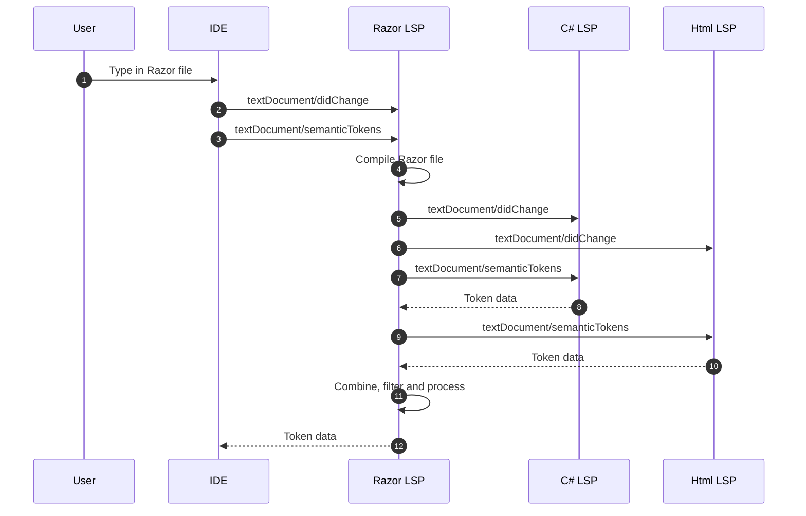
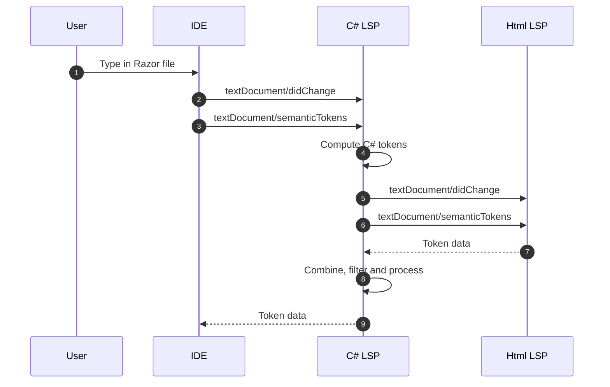

Just over 2 years ago, on December 7 2024, I opened a PR of the [Razor repo](https://github.com/dotnet/razor) that had a title of "[Initial cohost server implementation](https://github.com/dotnet/razor/pull/9674)", which was the first real step (though strictly speaking that PR was a follow up to [a Roslyn one](https://github.com/dotnet/roslyn/pull/70819) because this whole project is an annoying mess of multi-repo work) to realising an idea that I'd had a few months earlier, about to solve a large number of performance and reliability issues with Razor tooling, once and for all. The feature is called "Cohosting", though I can't take credit for the name, and at the time of writing its in [Visual Studio 2026 Insiders](https://visualstudio.microsoft.com/insiders/), and in the release and pre-release editions of the [C# Extension](https://marketplace.visualstudio.com/items?itemName=ms-dotnettools.csharp) for [Visual Studio Code](https://code.visualstudio.com/), and coming very soon to [Visual Studio 2026](https://visualstudio.microsoft.com/) release. So I figured I'd write down what it is.

> A note about LSP: The Razor editor in both Visual Studio Code and Visual Studio since v17.0, the first release of Visual Studio 2022, was and is an LSP based editor. To get it out of the way, cohosting does not change this. If I accidentally refer to "the LSP editor" below, I just mean "the non-Cohosting editor", but I find that a little awkward to say.

## The old way

It's hard to talk about a new architecture, without first having some understanding of what the old architecture is, so lets start there. The various Razor file formats (`*.cshtml` and `*.razor`) are really 5 programming languages in a trenchcoat. It combines the Razor language itself, plus C#, Html, JavaScript and CSS all together in one file. In order to provide the best editing experience for these languages, we don't want to have to handle all of those languages ourselves, but rather we want to defer to the experts, in this case the C# and Html editors respectively. We rely on the Html Editor is responsible for answering questions about JavaScript and CSS as well, and it might delegate to those specific editors in turn. So realistically in tooling, we  think of us as really having to deal with three languages: Razor, C# and Html.

Being LSP-based, the logical way for the Razor editor to talk to the C# or Html editors is via LSP, so in order to edit one Razor file, there are actually (at least) three LSP servers running. The two LSP servers that Razor delegates to need to be kept up to date with the contents of the Razor file, but of course those servers don't understand Razor syntax, for the same reason that we don't want to understand Html or C# syntax, so one of the most important, and most complicated, parts of Razor tooling is keeping everything in sync. When you type into a Razor file, the Razor editor has to compile that file into C# and Html sub-documents, send those sub-documents over to their respective LSP servers, and, most importantly, know what those servers have already seen.

Given LSP is a system whereby an IDE needs to keep a server up to date with text changes, the actual updating is relatively easy. The hard part is knowing when to update, when and what has already been updated. If, for example, Razor were to ask Roslyn, "If the user were to invoke Go To Definition on line 10, character 7 of this file, where would you take them?", it's not going to go well if the update to Roslyn that fills in the details about line 10 hasn't been sent yet. Equally it won't go well if Roslyn gets sent that update twice, or Roslyn wasn't in the state that Razor thought it was before sending the update, since we want updates to be as small a change as possible, for performance reasons.

When the LSP servers get out of sync, it's almost impossible for any feature to work correctly, and frustratingly, it's almost impossible for either server to know that they're out of sync. This has resulted in some humorous bugs in the past—the most obvious visual one being what we semi-affectionately call "disco colours". Let's look at a worked example of how this happens, as it will highlight not just the problem, but also the general architecture and pattern of behaviour of the system.

As you can see, its a reasonably long process involving multiple requests. There is unseen risks, by virtue of the `didChange` messages only containing the change to the document, thereby relying on each servers understanding of "current" state being in sync. Additionally there is extra complication due to the fact that this is just one request that might be sent from the IDE. It would also be asking for folding regions, diagnostics, symbols, completion (IntelliSense) etc. All of these requests have to do basically the same thing, except of course we only want to compile the Razor file once, and only want to update the delegated servers once.

## The new hotness

By comparison, the new process is much simpler. Lets jump straight to the diagram to really illustrate the differences.

